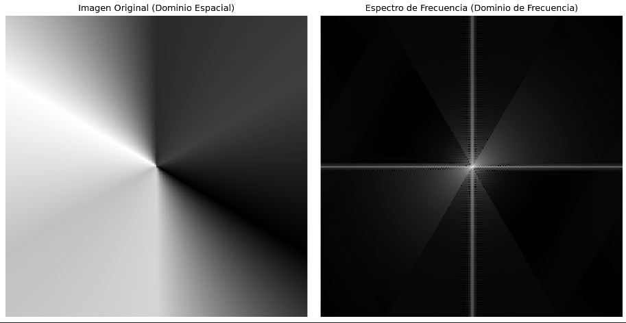
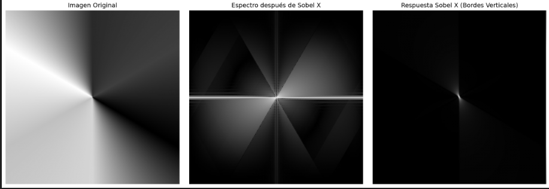
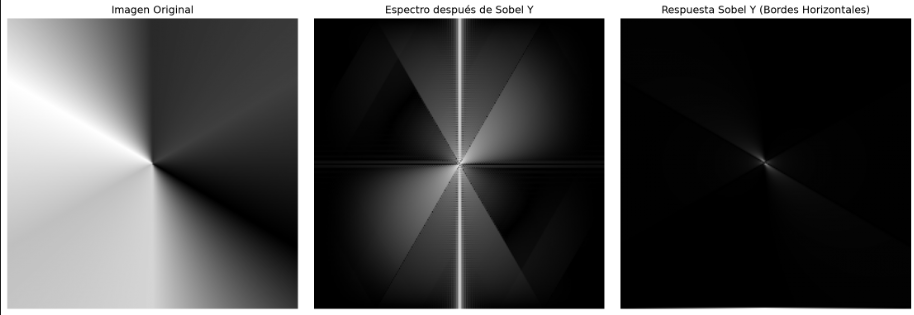
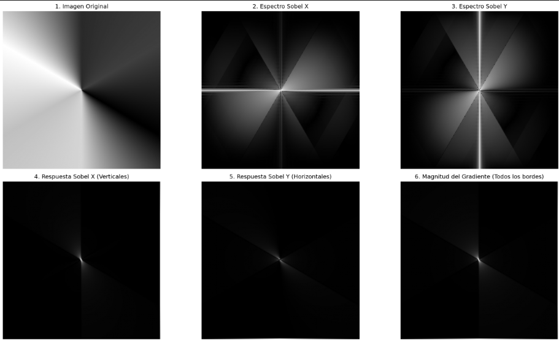
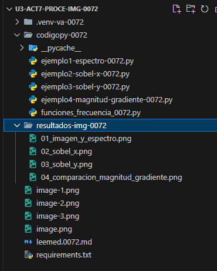

# 1. Propósito de la práctica
Que los estudiantes comprendan cómo se pueden detectar bordes y cambios de intensidad en una imagen utilizando los filtros Sobel X y Sobel Y en el dominio de la frecuencia.

# catherine rascon NC = 0072 
# problema 29. 🌈 Rueda de colores HSV

## ejemplo 1 

## ejemplo 2 

## ejemplo 3 

## ejemplo 4 

## estructura de carpetas 
